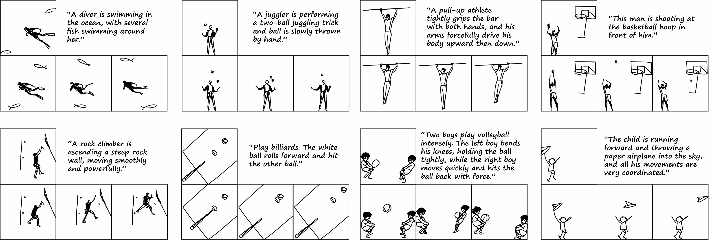

# GroupSketch: Multi-Object Sketch Animation with Grouping and Motion Trajectory Priors

<div align="center" style="line-height: 1;">

[](https://hjc-owo.github.io/GroupSketchProject/) 


</div>

This repository contains the official implementation of our ACM MM 2025 paper, "Multi-Object Sketch Animation with Grouping and Motion Trajectory Priors." 

## 🔥 Latest Update

- _2025.08_: 🎉 We released the code for [GroupSketch](https://hjc-owo.github.io/GroupSketchProject/). 🎉
- _2025.07_: 🎉 GroupSketch accepted by ACM MM 2025. 🎉

## 🌟 Highlights

- **Novel Two-Stage Pipeline**: Combines user-defined grouping with motion trajectory priors for multi-object sketch animation
- **Group-based Displacement Network**: Features Context-conditioned Feature Enhancement for improved temporal consistency
- **Superior Performance**: Significantly outperforms existing methods in visual quality and temporal consistency for complex multi-object scenarios
- **Interactive Web Interface**: User-friendly Flask-based web application for easy sketch animation creation


## 🚀 Getting Started

### Installation

1. **Clone the repository**:
```bash
git clone https://github.com/Yukinonooo/GroupSketch.git
cd GroupSketch
```

2. **Set up the conda environment**:
```bash
conda env create -f requirements.txt
conda activate groupsketch
```

3. **Install PyDiffVG** (Essential for vector graphics rendering):
```bash
git clone https://github.com/BachiLi/diffvg.git
cd diffvg
git submodule update --init --recursive
python setup.py install
```


## 🎨 Usage

### Quick Start - Web Interface

1. **Launch the web application**:
```bash
python app.py
```


2. **Upload your sketch**: 
  - Support formats: SVG, PNG, JPG
  - Automatic SVG conversion for raster images

3. **Define object groups**:
  - Use the interactive Canvas to group related objects
  - Set motion trajectories for each group

4. **Generate animation**:
  - Configure animation parameters (duration, frames, etc.)
  - Click "Generate Animation" to start processing

## 🎬 Interactive Tutorial

**Experience GroupSketch in Action**: Watch our comprehensive walkthrough demonstrating the complete workflow from sketch upload to animation generation.

<div align="center">

### 🖱️ Canvas Web Interface Demo

[](./assets/operation_tutorial.mp4)

**[📹 Click here to watch the complete tutorial](./assets/operation_tutorial.mp4)**

*Complete end-to-end demonstration of the GroupSketch web interface, showcasing object grouping, motion trajectory definition, and real-time animation generation.*

</div>

> **💡 Pro Tip**: Follow along with the tutorial using your own sketches to master the GroupSketch workflow!

## 📊 Features

### Core Capabilities

- ✅ **Multi-object sketch animation** with automatic object detection
- ✅ **Group-based motion control** for complex scene animation
- ✅ **Temporal consistency** through advanced neural networks
- ✅ **Real-time preview** in web interface
- ✅ **Batch processing** for multiple sketches
- ✅ **SVG export** for scalable vector animations

### Supported Input Formats

- **SVG**: Native vector format 

### Output Formats

- **MP4 video**: Frame-based animation export
- **GIF**: Animated GIF for web sharing
- **SVG sequence**: Individual SVG frames
- **PNG sequence**: Rasterized frame sequence


<!-- ## 📚 Citation

If you use this code in your research, please cite our paper:

```bibtex
@inproceedings{groupsketch2025,
  title={Multi-Object Sketch Animation with Grouping and Motion Trajectory Priors},
  author={Your Authors},
  booktitle={Proceedings of the 33rd ACM International Conference on Multimedia},
  year={2025}
}
``` -->


## 📄 License

This project is licensed under the MIT License - see the [LICENSE](LICENSE) file for details.

## 💘 Acknowledgements

This project is built upon the incredible work of:

- [LiveSketch](https://github.com/yael-vinker/live_sketch)
- [FlipSketch](https://github.com/hmrishavbandy/FlipSketch)

Special thanks to the authors and contributors of both projects!


## 📄 License

This project is licensed under the **MIT License**.

## 📬 Contact

For questions, bug reports, or collaboration inquiries, please feel free to open an issue or submit a pull request on
GitHub.

---

**Star ⭐ this repository if you find it helpful!**